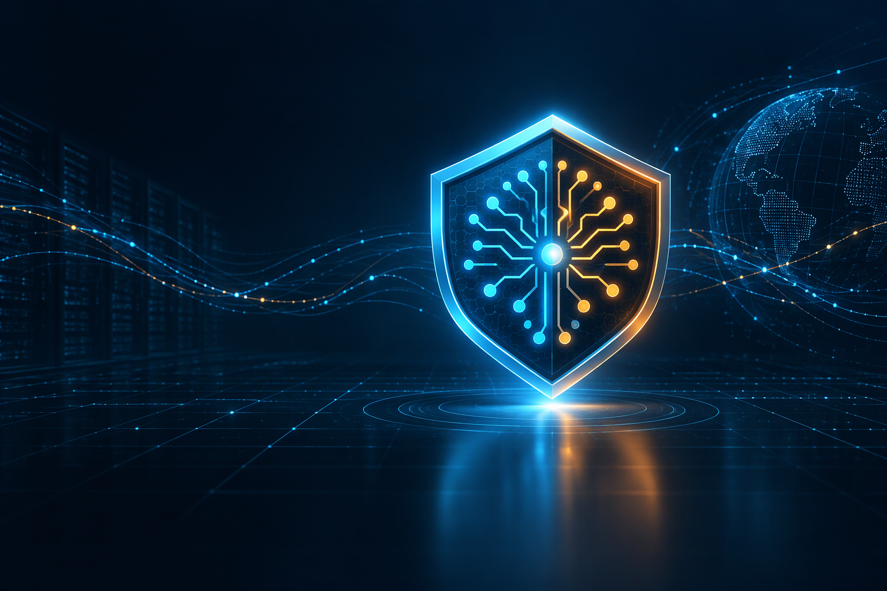

<p align="center">
  
</p>

<h1 align="center">AI Cyber Shield</h1>

<p align="center">
  <strong>Open-source, AI-assisted web security testing — runs entirely on your own machine.</strong>
</p>

<p align="center">
  <a href="#-quick-start-windows"></a>
  <a href="LICENSE"></a>
  <a href="#-authorized-testing-only"></a>
  
</p>

---

AI Cyber Shield pairs a **browser extension** that captures and categorizes web traffic with a **local AI harness** — a Kali Linux container running an [OpenCode](https://opencode.ai) server and a full suite of security tools. You browse a target you're authorized to test; AI agents read the captured traffic, reason about the attack surface, run low-impact checks against **in-scope** hosts, and write you a findings report.

Everything runs on your computer. Nothing is sent to our servers. A managed cloud edition is on the way — [join the waitlist](https://aicybershield.tech).

> ### ⚠️ Authorized testing only
> Use AI Cyber Shield **solely** on systems you own or have explicit, written permission to test (including bug-bounty programs, within their published scope). Unauthorized scanning is illegal in most jurisdictions. See [SECURITY.md](SECURITY.md).

## ✨ Why it's different

| | |
|---|---|
| 🧠 **AI does the triage** | Agents read the capture, map the attack surface, and decide what's worth testing — instead of you grepping through raw requests. |
| 🔒 **100% local & private** | Your traffic, cookies and tokens never leave your machine. The AI harness is a container on your own PC. |
| 🛡️ **Scope-enforced** | Every active scan needs an explicit scope. A guard inside the container refuses any out-of-scope target. |
| 🧰 **Real tooling** | nmap, nuclei, httpx, sqlmap, ffuf, nikto, whatweb, sslscan, subfinder and more — the tools you already trust, orchestrated. |
| 🔑 **Bring your own AI** | Works with OpenAI, Anthropic, Azure OpenAI, OpenRouter or local models. No lock-in, no hidden costs. |
| 📖 **Open source** | Apache 2.0. Read it, fork it, extend the agents. |

## 🧩 How it works

```
┌──────────────────┐     capture (JSON)      ┌─────────────────────────────────────────┐
│  Browser         │ ───────────────────────▶│  Local harness (Docker · Kali Linux)    │
│  extension       │                         │                                         │
│                  │                         │   ┌───────────┐     ┌─────────────────┐ │
│  • capture       │   scan status / report  │   │  Gateway  │────▶│  OpenCode server│ │
│  • categorize    │ ◀───────────────────────│   │  (FastAPI)│     │  + AI agents    │ │
│  • send to       │                         │   └───────────┘     └────────┬────────┘ │
│    harness       │                         │                     scope-guarded tools │
└──────────────────┘                         │              nmap · nuclei · httpx · …  │
                                             └─────────────────────────────────────────┘
```

1. **Capture** — the extension records requests, APIs, auth, cookies, headers and parameters while you browse an authorized target, then exports a categorized bundle.
2. **Analyze** — the bundle goes to the local gateway, which starts an AI agent in the OpenCode server.
3. **Assess** — in *passive* mode the agent reports only what's visible in the capture; in *active* mode it runs low-impact, non-destructive checks against the in-scope hosts you authorized.
4. **Report** — findings land in `harness/data/reports/`, ranked by severity with evidence and remediation.

## 🚀 Quick start (Windows)

**Prerequisites:** [Docker Desktop](https://www.docker.com/products/docker-desktop/) and Google Chrome.

### 1. Start the harness

```powershell
cd harness
.\start.ps1
```

First run generates local secrets, builds the container (downloads Kali + the tools — a few minutes), and prints your **Server URL** and **Token**. Add an AI provider key to `harness\.env` (e.g. `OPENAI_API_KEY=...`) and set `SHIELD_MODEL` (e.g. `openai/gpt-5`), then re-run `.\start.ps1`.

### 2. Install the extension

1. Open `chrome://extensions`, enable **Developer mode**.
2. **Load unpacked** → select the `extension` folder.
3. In the extension's **Local Harness** settings, paste the Server URL and Token.

### 3. Run an assessment

Browse your authorized target with capture on, stop capture, then **Send to Harness**. Add the target host(s) to the scan's scope, pick **passive** or **active**, and read the report in `harness\data\reports\`. You can also drive the agents directly in the OpenCode UI at `http://localhost:4096`.

## 🗂️ Repository layout

```
ai-cyber-shield/
├── extension/        Chrome extension (Manifest V3) — capture & categorize traffic
└── harness/          Kali + OpenCode Docker harness
    ├── gateway/        FastAPI service the extension talks to
    ├── workspace/      OpenCode agents, commands, and the scope guard
    ├── Dockerfile      Kali + tools + OpenCode image
    ├── docker-compose.yml
    └── start.ps1       Windows launcher
```

## ⚙️ Configuration

The harness reads `harness/.env` (created from `.env.example` on first run):

| Variable | Purpose |
|---|---|
| `SHIELD_TOKEN` | Token the extension uses to reach the gateway (auto-generated). |
| `OPENCODE_SERVER_PASSWORD` | Password for the OpenCode UI/API (auto-generated). |
| `SHIELD_MODEL` | `provider/model`, e.g. `openai/gpt-5`, `anthropic/claude-sonnet-4-5`. |
| `OPENAI_API_KEY` / `ANTHROPIC_API_KEY` / … | Your AI provider key. |

The harness listens only on `127.0.0.1` — nothing on your network can reach it.

## 🔐 Authorized testing only

AI Cyber Shield is built with guardrails — scope enforcement, rate limiting, non-destructive checks — but **you** are responsible for authorization. Only test what you're allowed to. Please read [SECURITY.md](SECURITY.md).

## 🗺️ Roadmap

- [x] Browser extension + local AI harness
- [x] Scope-enforced active scanning
- [ ] macOS / Linux launchers
- [ ] Managed cloud edition — [join the waitlist](https://aicybershield.tech)
- [ ] More agent playbooks and report formats

## 🤝 Contributing

Issues and pull requests are welcome — new agent playbooks, tool integrations, and platform launchers especially. By contributing you agree your work is licensed under Apache 2.0.

## 📜 License

[Apache License 2.0](LICENSE). Bundled third-party security tools retain their own licenses.

## 👤 Author

Built by **Harsh Jani**.

<sub>If AI Cyber Shield saved you time, you can <a href="support/upi-qr.png">buy me a coffee</a> ☕ (UPI / Google Pay).</sub>
